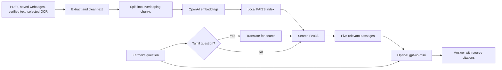

# Tamil Nadu Agriculture Schemes Assistant

**Agriculture schemes, made easier.** A bilingual Tamil and English assistant that helps farmers understand Tamil Nadu agriculture schemes, subsidies, crop insurance, irrigation support, and application guidance using government documents and saved public webpages.

This README explains both how to run the app and how its parts fit together.

## At a glance

| Layer | Technology | What it does here |
|---|---|---|
| User interface | Streamlit | Presents the farmer-facing site, language controls, sample questions, and cited answers. |
| RAG orchestration | LangChain | Connects document loading, retrieval, embeddings, and answer generation. |
| Embeddings | OpenAI `text-embedding-3-small` | Turns source text and questions into vectors that can be compared by meaning. |
| Vector search | FAISS | Stores and searches the locally saved document vectors. |
| Retrieval | FAISS MMR | Selects five relevant, varied passages for each question. |
| Answer model | OpenAI `gpt-4o-mini` | Produces a concise answer from retrieved passages and adds source labels. |
| PDF and OCR processing | PyMuPDF and Tesseract OCR | Extracts selectable PDF text and OCR text from scanned pages. |

This project currently uses OpenAI embeddings and `gpt-4o-mini`. It does not use Hugging Face embeddings or LangSmith tracing.

### In plain language

Think of the app as a helper that first looks through a small, prepared library, then explains the most useful passages. It does not ask the AI to answer from memory alone.

- **RAG** means *retrieval-augmented generation*: find relevant source text first, then use it to prepare the answer.
- **Chunks** are shorter pieces of a document. Splitting long PDFs makes it easier to find the passage about one particular question.
- **Embeddings** are number patterns that represent what a passage means. They help find related passages even when a question uses different wording.
- **FAISS** is the local search index that compares those number patterns and returns likely matches.
- **MMR** helps choose passages that are both relevant and less repetitive.

## Project structure

```text
RAG/
├── app.py                         # Main Streamlit site
├── build_faiss_index.py           # Loads, splits, embeds, and indexes source text
├── scrape_web_sources.py          # Saves text snapshots of URLs in the source list
├── ocr_preview.py                 # OCRs the micro-irrigation government order
├── check_pdf_text.py              # Checks PDFs for selectable text
├── extract_pdf_links.py           # Extracts PDF links for source collection
├── test_retrieval.py              # Example FAISS retrieval check
└── data/
    ├── pdfs/                      # Source government PDFs
    ├── web_sources/               # URLs and saved webpage text
    ├── processed/                 # OCR output and verified transcripts
    └── faiss_index/               # Generated local FAISS index
```

## How we built it

### 1. Collected the source material

The knowledge base combines Tamil and English agriculture policy documents, the 2026–27 interim budget, the micro-irrigation government order, and saved Agrimark webpages. The source PDFs are kept in `data/pdfs/`; webpage snapshots are kept in `data/web_sources/`.

### 2. Extracted and checked the text

`build_faiss_index.py` uses PyMuPDF to read text already present in PDFs. The micro-irrigation government order is scanned, so it did not provide selectable text. `ocr_preview.py` creates OCR text for that order. We also prepared verified transcripts for its first two pages because the funding table and order details need accurate figures. Of the remaining pages, OCR text is considered only for pages 3, 8, and 11–14, and only when it passes basic readability checks. The project does not manually verify every page of that scanned order.

### 3. Turned documents into searchable passages

The index builder combines readable PDF pages, saved webpage text, verified transcripts, and selected readable OCR pages. LangChain’s recursive text splitter breaks these into chunks of about 1,200 characters, with 200 characters of overlap so a fact near a chunk boundary is less likely to lose its context.

### 4. Built the search index

OpenAI `text-embedding-3-small` creates a vector for each chunk. FAISS saves those vectors and their source metadata under `data/faiss_index/`. The metadata keeps the source filename, PDF page when available, and source type so answers can cite where a passage came from.

### 5. Connected search to the assistant

When a farmer asks a question, the app searches the FAISS index for relevant passages. If the question is in Tamil, the app translates it into a short English search query; the answer is still returned in Tamil. The app then sends the question and retrieved passages to `gpt-4o-mini`. Its instructions tell it to use those passages, preserve figures, avoid guessing when evidence is missing, and cite factual claims.

### 6. Made the interface farmer-focused

The Streamlit site supports Tamil and English, offers sample questions for common topics, includes text-size controls, and shows the passages used below each answer. The current opening screen has a compact first view with the language and text-size controls available to users.

### 7. Checked representative questions

We tried five sample questions covering the micro-irrigation subsidy total, subsidy rates, application guidance, crop insurance, and seed assistance. The answers returned relevant citations for those checks. This is a spot check, not a full audit of every page or scheme in the knowledge base.

## How an answer is produced



## Run the site on Windows

### Requirements

- Python 3.14 (used in the current development environment).
- An OpenAI API key.
- The source data and generated index under the `data/` folder.

Open PowerShell in the project folder, activate the existing virtual environment, set the API key for that terminal session, and start Streamlit:

```powershell
.\venv\Scripts\Activate.ps1
$env:OPENAI_API_KEY = "YOUR_OPENAI_API_KEY"
streamlit run app.py
```

Streamlit prints a local address, usually `http://localhost:8501`. Keep the terminal open while using the site.

### Fresh environment

If you are setting it up on another computer, create a virtual environment and install the core packages:

```powershell
py -m venv venv
.\venv\Scripts\Activate.ps1
python -m pip install --upgrade pip
python -m pip install streamlit langchain-community langchain-openai langchain-text-splitters pymupdf faiss-cpu
```

The optional webpage scraper also needs:

```powershell
python -m pip install requests beautifulsoup4 pypdf
```

Set `OPENAI_API_KEY` in every new PowerShell session before running the app or building the index. Do not place the key in the source code or commit it to a repository.

## Updating the knowledge base

### Add documents or rebuild the index

Put PDFs in `data/pdfs/`, saved page text in `data/web_sources/`, and reviewed transcripts or OCR output in `data/processed/`. Then run:

```powershell
python build_faiss_index.py
```

The script replaces the index under `data/faiss_index/`. Building the index sends source text to the OpenAI API to create embeddings.

### Refresh the saved webpages

Update `data/web_sources/urls.txt`, then run:

```powershell
python scrape_web_sources.py
python build_faiss_index.py
```

The site answers from these saved snapshots. It does not perform a live web search when a farmer asks a question.

### OCR the scanned micro-irrigation order

`ocr_preview.py` writes `data/processed/micro_irrigation_full_ocr_raw.txt`. It needs Tesseract OCR with English language data; install Tamil language data too for Tamil OCR. The script currently expects Tesseract’s `tessdata` directory at `C:\Program Files\Tesseract-OCR\tessdata`. If yours is elsewhere, update `TESSDATA_FOLDER` in `ocr_preview.py`. Review OCR output before indexing figures that matter.

## What the assistant can and cannot do

It can explain information found in its indexed sources and show the source passages used. It cannot check live scheme availability, confirm an individual farmer’s eligibility, submit an application, or track an application’s status. Confirm current deadlines and requirements with the Agriculture Department before acting.

## Data and API use

The source files and FAISS index are stored in the project folder. When the index is built, source text is sent to OpenAI for embeddings. When someone asks a question, the question is embedded and the question plus retrieved passages are sent to the configured OpenAI API to prepare the answer. Avoid entering Aadhaar numbers, bank details, or other personal information.

## Utility scripts

| Script | Purpose |
|---|---|
| `app.py` | Run the main assistant site. |
| `build_faiss_index.py` | Build the local FAISS index from available source text. |
| `scrape_web_sources.py` | Save readable text from URLs listed in `data/web_sources/urls.txt`. |
| `ocr_preview.py` | OCR the micro-irrigation government order. |
| `check_pdf_text.py` | Check whether PDF pages contain selectable text. |
| `extract_pdf_links.py` | Help collect PDF source links. |
| `test_retrieval.py` | Run an example question against the saved FAISS index. |
