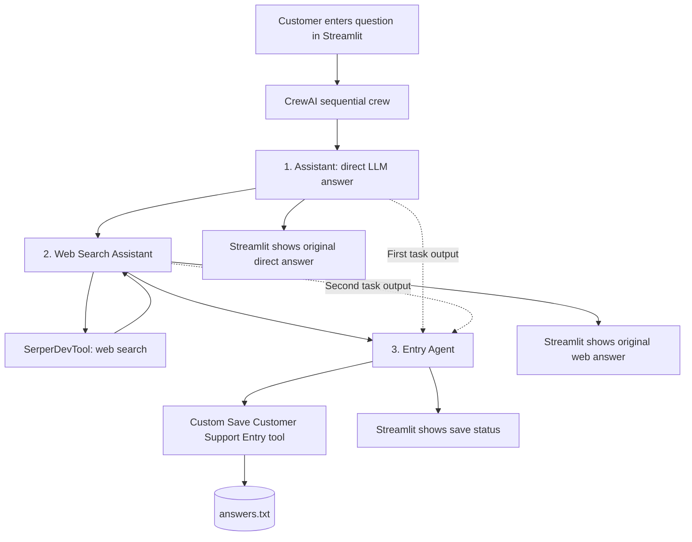

# Multi-Agent Customer Support | CrewAI + Streamlit

A Python application that answers customer questions in two complementary ways: a direct LLM response and a web-researched response. Three specialized CrewAI agents run **sequentially**, and the third agent saves the question and both answers to a local text file. A Streamlit interface presents the two answers side by side.

This is a demonstrator of multi-agent coordination, external-tool use, task-context transfer, and local record keeping. It is **not** a company-specific support knowledge-base bot or a RAG system.

## Features

- **Direct answer:** An Assistant agent responds from the language model's existing knowledge, without web tools.
- **Web-grounded answer:** A Web Search Assistant uses Serper.dev via `SerperDevTool` and is instructed to provide source URLs.
- **Persistent local records:** An Entry Agent receives both earlier task outputs and invokes a custom `@tool` function to append the query and both answers to `answers.txt`.
- **Sequential coordination:** `Process.sequential` ensures the agents execute in order.
- **Browser interface:** Streamlit accepts a question, displays both answers, reports the save status, and offers a text-file download.
- **Environment-based credentials:** OpenAI and Serper keys are read from the local environment / `.env` file, not stored in source code.

## Architecture



**Important:** A sequential crew controls execution order; the `context` parameter explicitly provides earlier task outputs where needed. The first two answers shown in the interface are taken from `result.tasks_output`, rather than regenerated by the Entry Agent.

## How the three agents work

| Agent | Tools | Task | Output |
| --- | --- | --- | --- |
| **1. Assistant** | None | Answer the user's question from general model knowledge | Direct answer |
| **2. Web Search Assistant** | `SerperDevTool()` | Search for relevant information and draft a response with links | Web answer |
| **3. Entry Agent** | Custom `save_customer_support_entry` tool | Record the original question and both preceding answers | Save confirmation |

The code constructs a `Crew` with `Process.sequential`, then calls `crew.kickoff()` when the user submits a question. Agent 2 is explicitly instructed to search independently, even though it can see Agent 1's answer. Agent 3 gets `context=[answer_task, web_task]`.

### The file-writing tool

The `@tool("Save Customer Support Entry")` decorated Python function accepts three text fields (`query`, `assistant_answer`, `web_answer`) and appends a timestamped entry to `answers.txt` using UTF-8 encoding. The file is stored next to `app.py` and is **appended to**, not overwritten, on later runs.

Because the Entry Agent is an LLM-driven agent, it is instructed to call the tool and preserve the answers exactly, but **the application does not programmatically guarantee that the tool will be called or that the text recorded will be byte-for-byte identical**. For a production audit log, application code should save the original task outputs directly after execution and verify the written file.

## Technology stack

| Technology | Purpose |
| --- | --- |
| Python 3.12 | Application runtime |
| CrewAI | Agents, tasks, execution sequence, custom tools |
| OpenAI (`gpt-4o-mini`) | Model used by all three agents |
| `crewai-tools` / Serper.dev | Online search for the second agent |
| Streamlit | Web UI and answer display |
| `python-dotenv` | Loading API credentials from `.env` |

There is **no FAISS/ChromaDB or document ingestion** in this application. Unlike the earlier RAG customer support example, this project deliberately compares a direct LLM response with a web-search-assisted response.

## Project structure

```text
buildathon-support-crew/
├── app.py            # Entire application: agents, tasks, tools, UI
├── README.md         # Architecture, setup, usage, and implementation guide
├── .gitignore        # Excludes credentials and local-generated files
├── .env              # Local API keys; excluded from Git
├── venv/             # Local virtual environment; excluded from Git
└── answers.txt       # Generated customer records; excluded from Git
```

Only **`app.py`** contains application code. The README and `.gitignore` are project documentation and repository configuration.

## Setup — Windows Command Prompt

1. Open CMD in the project directory and create a Python 3.12 environment:

   ```cmd
   cd C:\Users\prith\buildathon-support-crew
   py -3.12 -m venv venv
   venv\Scripts\activate
   ```

2. Install the packages:

   ```cmd
   python -m pip install crewai crewai-tools streamlit python-dotenv
   ```

3. Create a `.env` file alongside `app.py`:

   ```dotenv
   OPENAI_API_KEY=replace_with_your_openai_api_key
   SERPER_API_KEY=replace_with_your_serper_dev_api_key
   ```

   Use a **Serper.dev** key, not a SerpAPI key. Do not share credentials in screenshots or commit `.env` to Git.

4. Start Streamlit:

   ```cmd
   python -m streamlit run app.py
   ```

5. Open `http://localhost:8501` (the address Streamlit normally displays). To stop, press **Ctrl+C** in CMD; to leave the environment, run `deactivate`.

**Do not run `python app.py`.** Streamlit needs to launch the script through its own runtime to provide browser interaction and session-state support.

## Example workflow

**Input:** `How do I reset my password?`

1. The Assistant produces general password-reset instructions from the LLM's knowledge.
2. The Web Search Assistant searches with Serper.dev and produces an answer with relevant web references.
3. The Entry Agent receives the original question and both task outputs and calls the file-writing tool.
4. Streamlit renders the two answers in separate columns, shows the saving result, and offers **Download answers.txt** when the file exists.

The actual answer text depends on the model and available web results. For platform-specific procedures, ask about the platform explicitly; this application has no access to a private organization's password-reset policy.

### Sample stored record (illustrative)

```text
Timestamp: <local timestamp>
Customer query: How do I reset my password?

Assistant answer:
<direct assistant response>

Web search answer:
<web-assisted response with links>
======================================================================
```

## Understand the important code

**`@tool`** — The decorator exposes a Python function to a CrewAI agent as a callable tool. Here it gives the Entry Agent a real file-writing operation rather than merely asking it to *describe* a saved file.

**`SerperDevTool()`** — A web-search tool assigned only to the Web Search Assistant. The direct Assistant has `tools=[]`, so it cannot use this search tool.

**`Task`** — Defines each agent's work. Each task specifies a description, an expected output, and its assigned agent.

**`context=[answer_task]`** — Gives Agent 2 access to the first task's result while still instructing it to do independent web research.

**`context=[answer_task, web_task]`** — Supplies both preceding answers to Agent 3 so it can record them.

**`Process.sequential`** — Runs tasks in the specified order: direct answer → web answer → file entry.

**`crew.kickoff()`** — Executes the crew. Its `tasks_output` contains each task's answer, allowing the UI to show the originals directly.

**`st.form`, `st.columns`, `st.download_button`** — Provide user input, side-by-side presentation, and text-file download.

## Testing and verification

Run the app and check:

- [ ] Submitting a question displays the direct answer in the first column.
- [ ] The second answer includes relevant web information and, where available, links.
- [ ] CrewAI execution logs or search-provider usage confirm that `SerperDevTool` actually ran; links alone do not prove a live search.
- [ ] `answers.txt` is created in the project folder.
- [ ] The file contains the question and both responses, including a new timestamped record for subsequent questions.
- [ ] The Entry Agent reports saving success only when its tool confirms success.
- [ ] Empty input is rejected and missing API keys produce a clear error.

The application has been observed displaying two answers and a downloadable text record. Independent verification of the on-disk file and the web-tool invocation is still recommended.

## Security, limitations, and future improvements

- **Credentials:** `.env` and the virtual environment should remain outside version control.
- **Customer privacy:** `answers.txt` may contain sensitive questions and answers. It is intentionally excluded from Git. Avoid entering actual secrets or personal information in this demonstration.
- **No internal policy authority:** Generic LLM answers and public web content may not reflect a particular company's official process.
- **Tool-call reliability:** Agent tool use is prompted, not strictly enforced by the architecture. Production systems should validate successful search and logging steps.
- **Untrusted web content:** Search results may be inaccurate, outdated, or malicious; verify consequential claims against authoritative sources.
- **Failure handling:** The Streamlit interface catches exceptions and shows an error, but retry logic, structured logs, and operational monitoring are not implemented.
- **Potential improvements:** Programmatically persist exact task outputs, validate citations, add source quality checks, enforce access controls, and connect to an approved internal knowledge base if company-specific support becomes necessary.

## Outcomes

This project demonstrates **sequential multi-agent orchestration**, **role-specific tool permissions**, **context sharing between tasks**, **tool-based file persistence**, and **a working browser interface** that surfaces two different answer-generation approaches.

## References

- [CrewAI documentation](https://docs.crewai.com/)
- [CrewAI tools](https://docs.crewai.com/en/concepts/tools)
- [Streamlit documentation](https://docs.streamlit.io/)
- [Serper.dev](https://serper.dev/)
