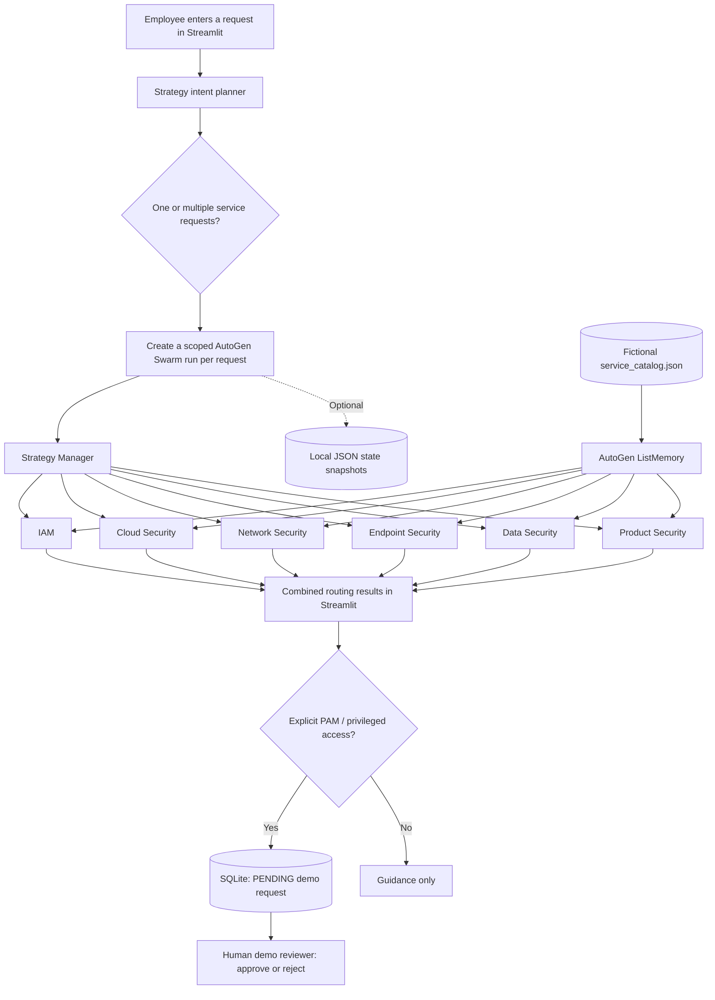

# Cybersecurity Support Center

**An AutoGen-powered, multi-agent cybersecurity service-routing application with a Streamlit dashboard, specialist handoffs, simulated PAM approvals, service memory, and optional state checkpoints.**

Employees often know the problem they are facing but not which security function owns it. This application accepts a natural-language request, separates combined requests into distinct service needs, and routes each need to an appropriate specialist agent. The resulting guidance is displayed in a single, easy-to-use support dashboard.

> **Prototype and security disclaimer:** All service ownership rules and examples are fictional demonstration data. This application is **not** connected to an employer's internal systems. It does **not** open tickets, approve real access, provision accounts, change permissions, or replace official incident-response procedures. Never enter real credentials, secrets, employee records, or confidential information.

## Features

- **Strategy-led routing:** A planning agent identifies separate requests; a Strategy Manager agent hands each scoped request to a specialist.
- **Six specialist agents:** Identity & Access Management (IAM), Cloud Security, Network Security, Endpoint Security, Data Security, and Product Security.
- **Multi-intent support:** One message can produce multiple recommendations, such as VPN troubleshooting **and** service-account creation.
- **Streamlit dashboard:** Compact service directory, request form, visible routing results directly below the form, a **Clear / New request** action, and an expandable agent-activity panel.
- **Human-in-the-loop concept for PAM:** Explicit privileged-access requests create simulated `PENDING` records; a local reviewer interface records `APPROVED` or `REJECTED` decisions.
- **Service reference memory:** AutoGen `ListMemory` provides fictional service-catalog information to specialist agents.
- **Optional state snapshots:** A checkbox enables serialization of AutoGen Swarm state to local JSON checkpoints.
- **State/memory validation script:** Demonstrates querying memory and restoring a previously saved team state into a new team to run a follow-up.

## Architecture



**Orchestration detail:** The Strategy *intent planner* separates compound questions into JSON entries. Each entry is then handled by a **fresh** AutoGen `Swarm`, beginning with the Strategy Manager, which makes the specialist handoff. These per-request Swarm executions are sequential. They are not a single parallel seven-agent conversation.

## Project structure

Place the files at the **same folder level** shown below. You do not need separate `agents/`, `tools/`, or `data/` source folders: the current Python imports expect files in the project root.

```text
Cyber Support Agent/
│
├── app.py                        # Streamlit web UI; calls planning + routing; renders results
├── main.py                       # Optional command-line test entry point
├── agents.py                     # Strategy planner, Strategy Manager and 6 specialist agents
├── workflow.py                   # AutoGen Swarm creation and termination conditions
├── agent_memory.py               # Builds ListMemory from the fictional service catalog
├── state_store.py                # Writes/reads JSON team-state checkpoints
├── approval_store.py             # Local SQLite register for simulated PAM decisions
├── service_catalog.json          # Fictional team scopes and recommended next steps
├── validate_state_memory.py      # Optional memory and state-restore validation
├── README.md                     # Project documentation (this file)
├── .gitignore                    # Keeps secrets, runtime state and temporary data out of Git
├── .env                          # Local credentials; never commit
├── venv/                         # Local Python virtual environment; never commit
│
└── runtime_data/                 # Generated automatically at runtime; never commit
    ├── pam_approvals.sqlite3     # Local simulated approval statuses and reviewer notes
    └── team_states/             # Optional saved Swarm checkpoint JSON files
        └── <timestamp>_<id>.json
```

### What each file does

| File | Responsibility | When used |
|---|---|---|
| `app.py` | Streamlit page, request validation, multi-intent execution, specialist cards, activity view, reviewer sidebar, optional checkpoint display | Launching the web app |
| `agents.py` | Defines the allowed routes, creates the Strategy intent planner, Strategy Manager, and six specialist `AssistantAgent`s | Every routing operation |
| `workflow.py` | Creates the AutoGen `Swarm` and its stop condition (`ROUTING_COMPLETE` or a message limit) | Each scoped specialist request |
| `service_catalog.json` | Stores **fictional** team names, scopes and next-step guidance | Loaded by agents and memory |
| `agent_memory.py` | Loads the catalog into AutoGen `ListMemory` | When building service memory |
| `approval_store.py` | Creates, lists, retrieves and updates simulated PAM requests in SQLite | When privileged access is requested or a reviewer acts |
| `state_store.py` | Persists and reads serialized AutoGen state dictionaries | When checkpoint saving is enabled |
| `validate_state_memory.py` | Queries memory; finds a saved checkpoint; restores it into a new Swarm; runs a follow-up | Optional terminal validation |
| `main.py` | Minimal terminal-based agent routing test | Optional CLI testing |
| `.env` | Stores `OPENAI_API_KEY` and `DEMO_REVIEWER_PASSCODE` locally | At startup |
| `.gitignore` | Excludes sensitive/generated local files | Git commits |

**Important:** `runtime_data/` is generated automatically; you should not create, publish, or commit database records or checkpoints. These may contain submitted messages.

## Technology stack

| Technology | Purpose |
|---|---|
| Python 3.12 | Application runtime |
| Microsoft AutoGen AgentChat | `AssistantAgent`, `Swarm`, handoffs, model context, team state |
| `autogen-ext[openai]` | OpenAI chat model client (`gpt-4o-mini`) |
| Streamlit | Interactive cybersecurity service dashboard |
| `autogen-core` | `ListMemory` reference memory |
| SQLite (`sqlite3`) | Local simulated PAM request and decision storage |
| JSON | Service catalog and optional serialized state |
| `python-dotenv` | Loading local environment variables |

## Getting started on Windows (Command Prompt)

### 1. Open the project

```cmd
cd "C:\Users\prith\Cyber Support Agent"
```

### 2. Create or activate a Python 3.12 environment

For a fresh clone:

```cmd
py -3.12 -m venv venv
venv\Scripts\activate
```

If `venv` already exists, only run the activation command.

### 3. Install dependencies

```cmd
python -m pip install -U autogen-agentchat "autogen-ext[openai]" streamlit python-dotenv
```

### 4. Create `.env` in the project root

```dotenv
OPENAI_API_KEY=your_openai_api_key
DEMO_REVIEWER_PASSCODE=choose_a_unique_local_demo_passcode
```

Do not use a corporate password as the demo passcode. Keep `.env` out of Git.

### 5. Launch Streamlit

```cmd
python -m streamlit run app.py
```

Open `http://localhost:8501` if the browser does not open automatically. Stop the server using **Ctrl+C**.

### Optional: Test the command-line agent

```cmd
python main.py
```

### Optional: Validate state and memory

First submit a fictional request in Streamlit with **Save AutoGen state checkpoints** enabled. Then run:

```cmd
python validate_state_memory.py
```

This script retrieves the demo memory entries, loads the latest checkpoint into a newly constructed Swarm, and attempts a follow-up. The restored team's **active agent can still be a specialist**, so this is not a production-safe routing mechanism for brand-new unrelated questions.

## How requests are processed

1. **Intake:** The employee describes one or more needs in the Streamlit text area.
2. **Intent planning:** `create_planner()` asks the Strategy planner to return a JSON list of `{request, team}` pairs. `parse_plan()` validates the response against supported team keys and limits it to six distinct requests.
3. **Agent handoff:** For each scoped request, `create_team()` creates a new Swarm. The `strategy_manager` starts the conversation and hands it off using AutoGen's handoff mechanism.
4. **Specialist advice:** The selected specialist reads its instructions and fictional service memory, then responds with **Team**, **Why this team**, and **Next step**.
5. **UI output:** Streamlit shows one result card per request, and the **Agent activity** expander lists the observed routing events.
6. **Optional checkpoint:** When enabled, the application saves the Swarm's serialized state to `runtime_data/team_states/` and allows it to be read back.
7. **Conditional PAM review:** Explicit privileged-access requests routed to IAM also create a local `PENDING` approval record.

### Example: Compound request

**Employee:** “My corporate VPN keeps disconnecting, and I need a new service account for testing.”

**Expected demonstration behavior:**

- **Network Security:** Guidance for the VPN issue.
- **IAM:** Guidance for the service-account request.

The Strategy planner should create two separate entries rather than choose only one primary team.

### Example: Avoid unsupported assumptions

A request for a **replacement laptop** does not automatically mean a stolen or compromised laptop. The Endpoint Security specialist should distinguish device-security incidents from hardware procurement and direct the employee to confirm whether the IT Service Desk or asset-management function actually owns replacements.

## PAM human-in-the-loop demonstration

An explicit request such as “I need privileged administrator access to a production server” is routed to IAM and creates a **simulated** approval record.

```text
Employee request → IAM routing → SQLite PENDING record
                  → Demo reviewer unlocks sidebar
                  → Approve or Reject
                  → SQLite status becomes APPROVED or REJECTED
```

- The reviewer interface uses `DEMO_REVIEWER_PASSCODE`, which is **not** enterprise authentication.
- The reviewer can add a decision note.
- SQLite persists the decision across Streamlit restarts.
- “APPROVED” means the **demo record** was approved. **No actual PAM or IAM privileges are granted.**
- This is an **application-level human approval gate**, not an AutoGen agent execution paused and resumed automatically after approval.

A real implementation would require corporate SSO, approver authorization, audit controls, genuine IAM/PAM integrations and formal policy enforcement.

## State, memory and observability

| Concept | Implementation | Important limit |
|---|---|---|
| **State** | `team.save_state()` and `team.load_state()`; JSON snapshots stored by `state_store.py` | Saving/reading a snapshot is different from automatic safe resumption |
| **Memory** | `ListMemory` created from `service_catalog.json` and passed to specialists | Not a vector database, not RAG, and not permanent employee memory |
| **Observability** | Swarm events/handoffs and specialist completion messages surfaced in the Agent activity panel | This is an activity view, not production tracing or centralized monitoring |
| **HITL** | Separate reviewer flow for simulated PAM decisions | Does not provision access or resume a paused AutoGen execution |
| **MCP** | Not connected in this version | Optional extension for approved external service catalogs or tools |

**Security note:** State checkpoints may contain questions and assistant messages. Use fictional inputs for demonstrations and do not commit saved states.

## Testing scenarios

| Test question | Expected behavior |
|---|---|
| “My VPN isn't connecting.” | Network Security |
| “I need a new service account.” | IAM |
| “Please review the security configuration of our AWS environment.” | Cloud Security |
| “I lost my company laptop.” | Endpoint Security and incident-handling guidance based on the stated incident |
| “I need a replacement laptop.” | Device-related guidance without inventing a theft or compromise |
| “Sensitive customer information was shared in the wrong location.” | Data Security |
| “Our application has a critical vulnerability.” | Product Security |
| “I need a new service account and a VPN issue fixed.” | Separate IAM and Network Security responses |
| “I need PAM access to a production environment.” | IAM with simulated PENDING human review |
| “Who won the cricket match?” | No confident cybersecurity routing match |

**Validation status:** Terminal handoffs, Streamlit multi-request routing, simulated PAM decision recording, state checkpoint save/read, and a separate state/memory continuation test were exercised during development. The prototype is not a deployed, authenticated enterprise service and has not undergone production security testing.

## Current limitations and possible improvements

- **Service ownership is fictional.** Actual ownership may differ, particularly for laptop procurement, cloud-access provisioning or cross-team responsibilities.
- **LLM routing may be imperfect.** A Strategy planner can misclassify ambiguous or multi-intent questions. Production routing should add systematic evaluation, explicit ownership metadata and escalation rules.
- **No enterprise knowledge retrieval.** `ListMemory` holds a small reference catalog; there is no RAG index or authorized internal document search.
- **Approval security is only a demo.** A shared passcode is unsuitable for production, and approval does not enact privileged access.
- **State continuation is experimental.** A restored Swarm may resume with the last active specialist instead of the Strategy Manager; new unrelated questions should be reclassified.
- **MCP is not included.** Real external tools require careful permissions and approved connectors.
- **Operational readiness is not included.** Authentication, authorization, observability backends, deployment hardening, rate limiting, privacy controls and comprehensive tests would be needed before enterprise use.

## GitHub hygiene

Commit only source code and fictional configuration. Exclude:

```gitignore
.env
.env.*
!.env.example
venv/
.venv/
__pycache__/
*.py[cod]
runtime_data/
*.log
.streamlit/secrets.toml
```

Before committing, run `git status` and verify that no `.env`, SQLite database, checkpoint, private record or virtual environment files are staged. If a secret was ever committed, removing it from the latest commit does not necessarily remove it from history; rotate the exposed credential and address the repository history.

## Project outcome

This project demonstrates **manager-led multi-agent orchestration** with AutoGen, **multi-intent cybersecurity service routing**, a Streamlit support portal, **specialist handoffs**, a **simulated human approval gate**, reusable service-reference **memory**, optional **state persistence**, and an observable workflow. It is intended as a portfolio demonstration and a foundation for further development, not a replacement for a corporate support or identity-management system.
